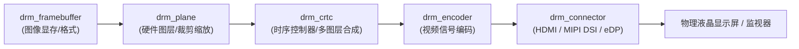

# K1/K3 显示系统与多媒体输出专题档案

> [!TIP]
> **💡 工程师导读与排坑焦点**：指导 HDMI/DSI 静电防护、电平转换电路、背光控制走线避坑，以及基于 Linux DRM/KMS 框架的 MIPI DSI / HDMI 屏幕驱动移植调试。
> **目标读者**：`硬件电路工程师 / 显示驱动 / 嵌入式软件工程师` | **技术领域**：`hardware_schematic_design`

本专题档案汇总了 SpacemiT K1 和 K3 处理器在显示输出接口（HDMI, MIPI DSI, SPI LCD）、硬件防静电设计、Linux DRM/KMS 显示流水线架构以及屏幕驱动移植调试方面的核心规范与避坑指南。

---

## 1. HDMI 接口设计与电气防护

K1/K3 芯片内置了 HDMI PHY，但在板卡设计时，外围电路必须进行电平转换与防静电（ESD）保护：
*   **电平转换规范**：
    *   **I2C 电平**：HDMI 的 `SCL` 和 `SDA` 信号在片外必须转换为 **5V** 逻辑电平。
    *   **HPD (热插拔) 信号**：接口输入的 `HDMI_HPD` 信号在送入 SoC 之前，必须通过分立电路或电平转换芯片**降压为 1.8V**，严禁将 5V 的 HPD 信号直接接入芯片引脚。
    *   **CEC 信号**：需将 `HDMI_CEC` 电平转换为 **3.3V**。
*   **静电防护 (ESD)**：
    *   所有的 HDMI 信号线上必须放置 **ESD 保护二极管**，且 ESD 器件必须尽可能靠近 HDMI 物理连接器。
    *   为了保证高速信号质量，ESD 器件的寄生电容必须**小于 0.3 pF**。

---

## 2. MIPI DSI 与 SPI LCD 接口避坑

*   **撕裂效应信号 (LCD_TE)**：用于同步液晶刷新，防止画面撕裂。由于管脚复用限制，`LCD_TE` 信号**不能同时**分配给 SPI 屏和 MIPI 屏。
*   **闲置模块供电**：如果项目完全不需要使用 LCD 液晶屏，**MIPI DSI 模块的模拟电源（如 `AVDD18_DSI`）也必须通过磁珠接入 1.8V 供电，绝对不能悬空不接**。

---

## 3. Linux DRM/KMS 显示流水线与屏幕驱动移植 (Panel Porting)

SpacemiT K1 与 K3 平台的显示驱动全面基于内核 **DRM (Direct Rendering Manager) / KMS (Kernel Mode Setting)** 框架实现：

### 3.1 核心组件职责
*   **`drm_plane`**：硬件图层抽象，负责从 framebuffer 读取显存，支持源区域裁剪、屏幕坐标缩放、透明度混合、Z 序排列（`zpos`）与旋转镜像。
*   **`drm_crtc`**：独立显示扫描管线，负责合成多个 Plane、控制 VBLANK 垂直同步、生成精确的行场扫描时序（Display Timings）。
*   **`drm_encoder` & `drm_connector`**：将像素流转换为接口传输标准，并提供热插拔检测（HPD）与显示器 EDID 读取。

### 3.2 MIPI DSI 屏幕移植调试要点
官方移植指南分别说明 U-Boot 与 Kernel 阶段。时序、Lane 和像素格式应按对应阶段的驱动、设备树 binding 与 Panel 规格配置，不把通用属性名当作所有 K1/K3 驱动的统一接口。

1. **DTS 显示时序参数 (Display Timing)**：
   依照液晶屏规格书核对有效宽高、行场同步与消隐、像素时钟及 DSI bit clock。具体字段按当前驱动的 DTS 或 Panel 结构填写；只有驱动支持相应 binding 时，才采用 `panel-timing` 等通用节点。
2. **硬件上电与复位时序 (Power & Reset Sequence)**：
   在驱动中按 Panel Datasheet 配置电源、延时、复位极性与初始化命令；分别验证 U-Boot 和 Kernel 的上下电流程，不直接套用其他屏的 RESET 电平与延时。
3. **MIPI Lane 通道配置**：
   在当前驱动支持的设备树属性或 Panel 配置结构中设置 Lane 数量和像素格式，核对控制器与屏的支持范围及 PCB 连接；不默认所有驱动都使用 `dsi-lanes` 属性。

---

## 4. 关联事实证据与参考源

> [!NOTE]
> **2026-08 官方更新**：K3 Datasheet 已更新至 **V1.6**（2026.07.15），主要变更为“更新视频子系统参数”。若你的设计涉及 K3 视频编解码能力，请以最新版本为准。

*   物理参数参见：[[Evidence/k1_k3_display_specs]] (HDMI/DSI 极限输出分辨率)
*   [SpacemiT K1 屏幕调试与移植指南（官方原始文档）](../Sources/docs-buildroot/zh/k1_buildroot/graphics/panel_porting_guide.md)
*   [SpacemiT K3 屏幕调试与移植指南（官方原始文档）](../Sources/docs-buildroot/zh/k3_buildroot/graphics/panel_porting_guide.md)
*   [K3 Datasheet V1.6 - 原始文档](../Sources/docs-chip/zh/key_stone/k3/k3_docs/k3_ds.md)
*   [K1 硬件设计指南 - 原始文档](../Sources/docs-chip/zh/key_stone/k1/k1_hw/k1_hw_design_guide.md)
*   [K3 硬件设计指南 - 原始文档](../Sources/docs-chip/zh/key_stone/k3/k3_hw/k3_hw_design_guide.md)
