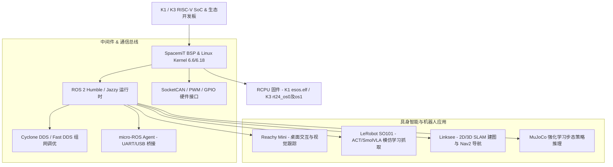

# SpacemiT ROS 2 机器人与具身智能专题档案

> [!TIP]
> **💡 工程师导读与排坑焦点**：详解 ROS 2 架构、micro-ROS 串口总线、LeRobot SO101 ACT 模仿学习与 SLAM 导航。
> **目标读者**：`机器人工程师 / 具身 AI 开发者` | **技术领域**：`edge_ai_robotics`

本专题档案系统性解构基于 SpacemiT K1 与 K3 RISC-V 芯片平台的 ROS 2（Robot Operating System）软件架构与具身智能（Embodied AI）应用生态。包含 ROS 2 Humble/Jazzy 运行时搭建、DDS 通信调优、micro-ROS 串口/硬件总线桥接、模仿学习模型 (ACT / SmolVLA) 端侧部署，以及 Reachy Mini、SO101 机械臂、Linksee 移动机器人的开发实践。

---

## 1. ROS 2 系统架构与中间件集成

SpacemiT 为端侧机器人开发提供了从底层 Linux 内核到上层机器人框架的全栈支持：



### 1.1 官方芯片与 ROS 2 平台支持基准

根据 `docs-ros@808d02c1bd11cf0d4376555919bd61c90e38d853` 的平台支持列表（来源与适用条件见 [[Evidence/ros2_platform_specs|SpacemiT ROS 2 平台规格表]]）：

| 芯片型号 | 当前支持的 ROS 2 版本 | 规划支持的 ROS 2 版本 | 当前推荐的操作系统 |
| :---: | :---: | :---: | :---: |
| **K3** | **Humble、Jazzy** | **Lyrical**（计划支持） | **Bianbu 4.x**（4.0.1 起） |
| **K1** | **Humble、Jazzy** | — | **Bianbu 2.3.x** |

Lyrical 是平台适配规划，尚未正式提供；各版本的软件包、驱动和功能支持范围以平台文档及发布说明为准，当前 SDK 示例主要基于 Humble。

> [!IMPORTANT]
> **多机通信版本一致性红线**：
> 官方建议**机器人端与上位机/工控机使用相同的 ROS 2 发行版**（例如统一采用 Humble 或统一采用 Jazzy），并按对应示例配置通信中间件、网络和 `ROS_DOMAIN_ID`。ROS 2 上游不保证不同发行版之间的节点通信兼容。

---

## 2. ROS 2 环境配置与 DDS 调优

### 2.1 Bianbu OS 与 Docker 部署

按上表对应的 Bianbu 系统和平台配套软件源安装 ROS 2 RISC-V 软件包，具体步骤使用各平台安装指南。下面保留既有 Docker 示例，复现前需核对镜像可用性、版本与板型，不将其等同于任意 Ubuntu 系统均可直接安装：

```bash
# 启动 ROS 2 镜像容器
docker run -it --net=host --privileged -v /dev:/dev spacemit/ros:humble-desktop
```

### 2.2 多节点 DDS 网络通信优化

对于需要同时传输 MIPI CSI 图像帧或 3D 激光雷达点云的机器人节点，利用 K1/K3 芯片的双 GMAC 以太网与 Cyclone DDS 进行多播流量调优：

```bash
export RMW_IMPLEMENTATION=rmw_cyclonedds_cpp
```

详细参数见 [[Evidence/ros2_platform_specs|ROS 2 平台支持与 DDS 参数]]。

---

## 3. micro-ROS 与底层硬件总线桥接

为了实现毫秒级硬件电机控制，SpacemiT 方案支持将高层逻辑运行于 K1/K3 主核，而将底层 PWM / 编码器计数交付给协同 MCU，并通过 `micro-ROS` 节点通信：

```bash
# 启动 micro-ROS Agent 串口节点
ros2 run micro_ros_agent micro_ros_agent serial --dev /dev/ttyS1 -b 115200
```

板级 JTAG / UART 与串口物理排针参考 [[Knowledge_Atoms/Muse_Pi_板级硬件设计专题|Muse Pi 板级硬件设计专题]] 与 [[Knowledge_Atoms/K3_COM260_板级硬件设计专题|K3 COM260 板级硬件设计专题]]。

---

## 4. 具身智能 (Embodied AI) 模仿学习与端侧部署

SpacemiT 提供了从轻量级端侧抓取到多模态具身大模型的多层级端侧部署支持：

### 4.1 SO101 机械臂与 LeRobot 模仿学习 (K1 / K3 分级方案)

* **K1 平台（2.0 TOPS AI / 8 核 X60 算力）**：
  * 支持轻量级 **ACT (Action Chunking with Transformers)** 模仿学习抓取策略。
  * 历史记录中的 **25 FPS** 尚未找到测试出处和条件，不作为已验证性能；见 [[Evidence/robot_hardware_specs|待复核机器人模型记录]]。
  * 命令行运行：
    ```bash
    python3 -m lerobot.scripts.control_robot --robot-type so101 --policy-type act --eval
    ```
* **K3 平台（60 TOPS AI / 8 核 A100 智算核）**：
  * 支持参数量更大的 **SmolVLA (Vision-Language-Action)** 多模态具身策略模型。
  * **待核验适配记录**：SmolVLA 的 4 子图拆解、执行后端及 **8 FPS** 闭环控制记录尚未完整定位官方出处，使用前需核对 SDK 版本、模型和测试条件。

### 4.2 Reachy Mini 桌面机器人 (K3-COM260)

官方 Reachy Mini Lite 适配方案使用 **K3-COM260**，头部为 **6 自由度**，外设包括 Sony IMX708 摄像头、PDM MEMS 数字麦克风、扬声器和 XL330 舵机。方案集成视觉跟随与 VAD / ASR / LLM / TTS 语音交互，支持纯本地模型或云端模型；官方该章节没有限定为 SpaceLLM 1B。来源定位见 [[Evidence/robot_hardware_specs|Reachy Mini 硬件记录]]。

### 4.3 Linksee 移动机器人 SLAM 导航 (K3 Pico / Muse Pi)

通过硬解码 (MPP) 处理 CSI 摄像头视频流，结合激光雷达点云，在 K3 Pico 上跑通 Cartographer 2D SLAM 建图与 Nav2 路径规划。

详细硬件与 AI 模型性能对比详见 [[Evidence/robot_hardware_specs|SpacemiT 机器人硬件与具身 AI 模型参数规格]]。
