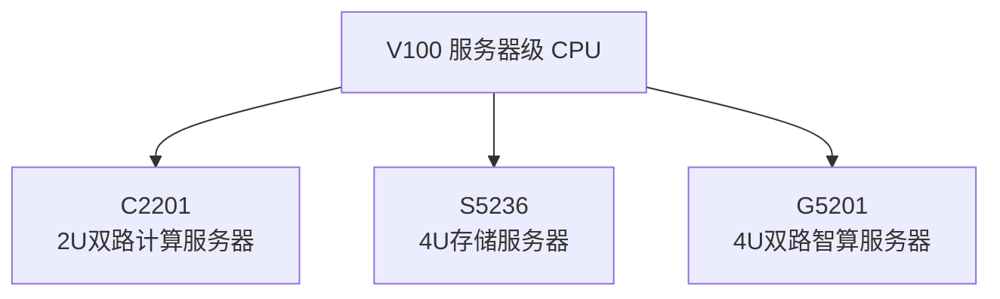

# SpacemiT V100 计算、存储与智算服务器专题档案

> [!TIP]
> **💡 工程师导读与排坑焦点**：
> 本文梳理基于 SpacemiT 服务器级 CPU **V100** 的 C2201 计算服务器、S5236 存储服务器与 G5201 智算服务器。
> 三款整机的形态与定位依据为 `docs-product@97026162fb37562a5e19fa4ca0ada6481e5ff455` 的中英文产品简介，具体配置与兼容范围需分别核实。
> **目标读者**：`系统架构师 / 服务器硬件工程师 / 数据中心工程师` | **技术领域**：`chip_product_specs`

> [!WARNING]
> **needs_review · 分类冲突记录（2026-10-19）**：旧稿 `269531b` 将三款设备归为工业与边缘硬件，与上述官方固定提交的产品简介存在冲突。下表保留原口径供人工复核；旧分类不能作为当前产品选型或对外承诺的依据。文件名及旧别名暂保留，避免既有链接失效。

| 型号 | 旧稿分类（保留历史，非当前依据） | 官方产品简介对应定位 |
| :--- | :--- | :--- |
| C2201 | 紧凑边缘计算单元，Compact/Edge 设备 | 2U 双路机架式计算服务器 |
| S5236 | 工业智算与高密主控板卡，Server/Smart 节点 | 4U 高密度机架式存储服务器 |
| G5201 | 智能通信与物联网网关，Gateway 设备 | 4U 双路高密度机架式智算服务器 |

---

## 1. V100 服务器产品定位与家族谱系

官方三款产品简介均以 **V100 服务器级 CPU** 为计算底座，覆盖通用计算、集中存储和加速卡智算场景。它们与 K1/M1 终端、K3 边缘平台的关系见 [[Knowledge_Atoms/Spacemit_产品矩阵与硬件生态全景档案|产品矩阵]]；不能由产品家族关联推导电源、接口或软件兼容性。

---

## 2. V100 系列产品线构成 (Products Portfolio)

以下分类取自 `docs-product@97026162fb37562a5e19fa4ca0ada6481e5ff455` 各型号产品简介的“概述”章节；对应英文页分类一致：

| 产品型号 | 官方产品代号 | 典型形态与应用方向 | 官方参考文档入口 |
| :--- | :--- | :--- | :--- |
| **C2201** | `v100_c2201` | 2U 双路机架式计算服务器；数据中心、云计算、科学计算和行业关键业务 | [C2201 简介，概述第 14～16 行](https://github.com/spacemit-com/docs-product/blob/97026162fb37562a5e19fa4ca0ada6481e5ff455/zh/v100_series/v100_c2201/root_overview.md#L14-L16) |
| **S5236** | `v100_s5236` | 4U 高密度机架式存储服务器；云存储、数据归档和备份容灾 | [S5236 简介，概述第 14～16 行](https://github.com/spacemit-com/docs-product/blob/97026162fb37562a5e19fa4ca0ada6481e5ff455/zh/v100_series/v100_s5236/root_overview.md#L14-L16) |
| **G5201** | `v100_g5201` | 4U 双路高密度机架式智算服务器；大模型推理、科学计算和智算中心 | [G5201 简介，概述第 14～16 行](https://github.com/spacemit-com/docs-product/blob/97026162fb37562a5e19fa4ca0ada6481e5ff455/zh/v100_series/v100_g5201/root_overview.md#L14-L16) |

> [!NOTE]
> **配置与发布范围**：该固定提交已提供三款产品简介正文及 PDF 下载入口。具体硬件配置、选配件、电气参数和交付状态应以对应产品资料与官方后续发布为准，不沿用旧稿“仅有页面框架、规格尚未上线”的描述。

---

## 3. 硬件与软件支持边界

*   **服务器平台**：C2201 与 S5236 简介列明 DDR5 内存与 PCIe 5.0 扩展；G5201 简介说明支持 8 张 PCIe 风冷加速卡。具体接口、功耗与配置上限需逐型号查证。
*   **软件兼容性**：各型号的操作系统与加速卡适配按其产品简介和配套发布说明确认，不从 K1/K3 的 Bianbu 或 ROS 2 适配结果外推。
*   **旧稿兼容性推断（待复核）**：原文曾称 V100 可无缝对接 K 系列 GMAC/DPDK/EtherCAT、采用相同 Power Stone 电源方案并全面支持 Bianbu/ROS 2。上述固定提交的产品简介没有为这些整套兼容性承诺提供依据，现保留为未核验历史记录，不作为方案支持结论。

---

## 4. 关联事实证据与参考源

*   顶层产品图谱：[[Knowledge_Atoms/Spacemit_产品矩阵与硬件生态全景档案]]
*   [V100 系列产品索引 - 原始文档](../Sources/docs-product/zh/v100_series/index.md)
*   [V100 系列产品索引 - 固定提交](https://github.com/spacemit-com/docs-product/blob/97026162fb37562a5e19fa4ca0ada6481e5ff455/zh/v100_series/index.md)
*   对应英文产品简介：同一提交的 `en/v100_series/v100_c2201/root_overview.md`、`en/v100_series/v100_s5236/root_overview.md` 与 `en/v100_series/v100_g5201/root_overview.md`，分类与中文页一致。
