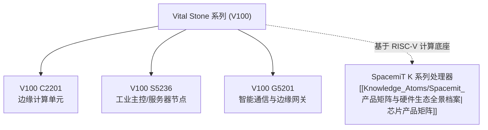

# SpacemiT V100 系列工业与边缘计算硬件专题档案

> [!TIP]
> **💡 工程师导读与排坑焦点**：
> 本文梳理 SpacemiT **Vital Stone（生命石）家族** 的核心硬件产品线 —— **V100 系列**（包括 C2201、S5236、G5201）。
> 涵盖其在产品谱系中的定位、产品线构成、底层技术依赖及官方发布动态。
> **目标读者**：`系统架构师 / 硬件工程师 / 嵌入式开发者` | **技术领域**：`chip_product_specs`

---

## 1. V100 系列产品定位与家族谱系

进迭时空官方硬件产品体系形成了以“三大基石”为核心的命名与代际版图：
1. **Key Stone（基石计算核心）**：[[Knowledge_Atoms/Spacemit_产品矩阵与硬件生态全景档案|K1 普惠 AI SoC 与 K3 高性能智算 SoC]]；
2. **Power Stone（伴随电源体系）**：[[Knowledge_Atoms/SpacemiT_P3_PMIC电源芯片专题档案|P1 / P1S / P3 PMIC 电源管理芯片]]；
3. **Vital Stone（行业与边缘应用硬件）**：**V100 系列工业与边缘计算硬件**。

V100 系列是面向工业控制、边缘智能计算与网关通信等行业场景推出的整机/板级硬件产品线。

---

## 2. V100 系列产品线构成 (Products Portfolio)

根据官方文档仓库（`Sources/docs-product` 及 `Sources/docs-chip`），V100 系列首批规划产品包括以下三大产品型号：

| 产品型号 | 官方产品代号 | 典型形态与应用方向 | 官方参考文档入口 |
| :--- | :--- | :--- | :--- |
| **C2201** | `v100_c2201` | Compact/Edge 边缘计算紧凑型设备 | [C2201 简介 (docs-product)](../Sources/docs-product/zh/v100_series/v100_c2201/root_overview.md) |
| **S5236** | `v100_s5236` | Server/Smart 工业智算与高密节点板卡 | [S5236 简介 (docs-product)](../Sources/docs-product/zh/v100_series/v100_s5236/root_overview.md) |
| **G5201** | `v100_g5201` | Gateway 工业边缘通信与物联网网关 | [G5201 简介 (docs-product)](../Sources/docs-product/zh/v100_series/v100_g5201/root_overview.md) |

> [!NOTE]
> **官方文档更新进度说明**：
> 官方 GitHub 上游于 2026 年 10 月正式引入了 V100 系列页面结构及 Vital Stone 横幅资源，各型号的详细硬件规格书（PDF）与电气参数处于陆续定稿上线阶段。本档案将随上游同步保持持续追踪与更新。

---

## 3. 底层计算底座与技术生态关联

V100 系列产品承载了 SpacemiT 全栈 RISC-V 软硬件技术体系：
*   **网络与工业总线支持**：针对工业级与网关应用，可无缝对接双路千兆 GMAC、DPDK 用户态旁路及 EtherCAT 工业现场总线协议栈，参见 [[Knowledge_Atoms/K1_K3网络通信与千兆网口专题档案|K1/K3 网络通信与千兆网口专题档案]]。
*   **电源与能效拓扑**：采用配套的 Power Stone PMIC 高效供电方案，满足工业宽温与低功耗需求，参见 [[Knowledge_Atoms/SpacemiT生态板卡与PMIC电源配合专题档案|SpacemiT 生态板卡与 PMIC 电源配合专题档案]]。
*   **具身智能与操作系统**：全面支持 Bianbu OS 发行版以及 ROS 2 机器人软件框架，参见 [[Knowledge_Atoms/SpacemiT_ROS2_机器人与具身智能专题档案|SpacemiT ROS2 机器人与具身智能专题档案]]。

---

## 4. 关联事实证据与参考源

*   顶层产品图谱：[[Knowledge_Atoms/Spacemit_产品矩阵与硬件生态全景档案]]
*   [V100 系列产品索引 - 原始文档](../Sources/docs-product/zh/v100_series/index.md)
*   [V100 芯片产品文档 - 原始文档](../Sources/docs-chip/zh/vital_stone/v100/v100_docs/index.md)
*   [V100 官方 Banner 资源](../Sources/docs-chip/zh/vital_stone/v100/banner.webp)
