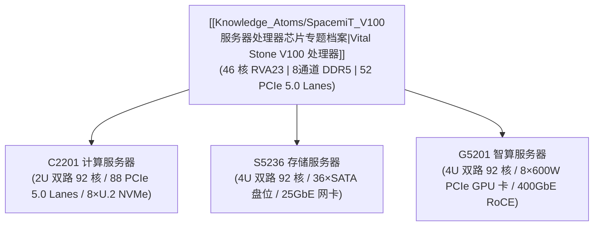

# SpacemiT V100 系列机架式服务器专题档案

> [!TIP]
> **💡 工程师导读与选型焦点**：
> 本文系统梳理基于 SpacemiT 服务器级 CPU **V100** 打造的 3 款企业级机架式服务器：**C2201 通用计算服务器**、**S5236 高密存储服务器** 与 **G5201 高性能智算服务器**。
> 底层芯片架构机理请下钻查阅 [[Knowledge_Atoms/SpacemiT_V100服务器处理器芯片专题档案|V100 处理器芯片专题]]；整机物理参数对比见 [[Evidence/v100_servers_specs|V100 整机参数对比表]]。
> **目标读者**：`系统架构师 / 数据中心运维工程师 / 解决方案架构师` | **技术领域**：`chip_product_specs`

---

## 1. V100 服务器产品家族谱系与定位

进迭时空 V100 服务器产品线以自研高性能 **Vital Stone V100 CPU** 为统一计算底座，满足云计算中心、海量大数据存储及 AI 智算中心等多元业务场景：

---

## 2. 三款服务器核心形态与选型矩阵

| 产品型号 | 物理形态 | 核心算力与内存配置 | 存储与 I/O 扩展亮点 | 典型部署场景 |
| :--- | :--- | :--- | :--- | :--- |
| **C2201** | **2U 双路机架式** 820 × 447.4 × 87.8 mm 重量 ≤ 35 kg | • **2 颗 V100（92 核）** • 16 个 DDR5 槽位（最高 2TB） • 4800 MT/s 速率 | • **88 条 PCIe 5.0 Lane** 扩展 • 前置 8×3.5" U.2 NVMe SSD • 内置 1×M.2 NVMe + 后置 2×2.5" SATA • 1600W CRPS 1+1 铂金冗余 | 公有云/私有云计算节点、微服务容器集群、高并发 Web 业务、科学计算与政企关键业务 |
| **S5236** | **4U 高密机架式** 820 × 447.4 × 176.9 mm 重量 55 kg | • **2 颗 V100（92 核）** • 16 个 DDR5 槽位（最高 2TB） • 4800 MT/s 速率 | • **前置 24 + 后置 12 共 36 盘位** • 2 个 2.5" SATA 系统盘位 • 标配 1×OCP3.0 + 2×25GbE 双口网卡 • 支持 3 个 RISER 扩展槽（网卡/RAID） | 分布式对象存储、海量视频监控归档、冷热混合数据湖、容灾备份中心 |
| **G5201** | **4U 高密智算机架式** 895 × 447.4 × 176.8 mm 重量 约 60 kg | • **2 颗 V100（92 核）** • 16 个 DDR5 槽位（最高 2TB） • 4800 MT/s 速率 | • **满配 8 张 600W PCIe 风冷加速卡** • 最高支持 **256 GB/s GPU 卡间互联** • 标配 1×OCP3.0 + **4×400GbE RoCE 网卡** • 4 个 CRPS 冗余电源（支持 N+1） | 大模型离线/在线推理、跨节点分布式算力集群、多模态预处理智算中心 |

---

## 3. 服务器通用基础架构与智能运维

三款服务器整机均遵循标准的服务器硬件规范与企业级管理体系：

1. **统一管理基板 (BMC)**：
   * 板载企业级 **AST2600 BMC 控制器**，提供专用带外管理网口与 Type-C 调试口；
   * 支持标准 **IPMI 2.0、Redfish RESTful API、SOL（Serial-Over-LAN）** 及远程 **KVM over IP** 与虚拟介质挂载；
   * 支持风扇智能 PID 调速与多传感器机箱环境动态温控，保持整机运行噪声低于 55 dB。
2. **电源与散热冗余体系**：
   * 采用标准企业级 **CRPS 冗余电源模组**（C2201 标配 1600W 1+1 冗余，G5201 标配 4 模块 N+1 冗余）；
   * 标配 N+1 冗余高速热插拔风扇模组（S5236 与 G5201 标配 12 个 6056 工业风扇），支持在线免工具热更换。
3. **前置与后置接口标准化**：
   * 前置与后置面板均提供 2 × USB 3.0 接口及 1 × VGA 调试接口；后置集成 1 × Type-C 调试口及独立 1GbE BMC 管理网口。

---

## 4. 软件栈与生态兼容边界

* **系统固件**：全面支持基于 **UEFI 2.11 / ACPI 6.6 / EDK2** 的标准引导固件。
* **操作系统**：深度兼容 openEuler、openKylin、Ubuntu Server、Red Hat Enterprise Linux、Fedora、Rocky Linux 及 openRuyi 等主流发行版。
* **虚拟化支持**：在两颗 V100 处理器支持下，整机提供 92 个实体核心，依托 RVH 1.0、AIA 1.0 与 IOMMU 1.0，可在 KVM 下大规模并发运行虚拟机，物理损耗大幅降低。
* **边界提示**：V100 系列整机面向企业级数据中心，**严禁套用端侧单板开发套件的 Bianbu OS 桌面镜像或 ROS 2 机器人环境**。

---

## 5. 关联事实证据与参考出处

* **芯片级底层专题**：[[Knowledge_Atoms/SpacemiT_V100服务器处理器芯片专题档案]]
* **整机全量硬数据表**：[[Evidence/v100_servers_specs|V100 系列机架式服务器整机物理规格参数对比表]]
* **芯片技术指标证据**：[[Evidence/v100_chip_specs|Vital Stone V100 服务器级 CPU 核心技术规格参数]]
* **全局硬件图谱**：[[Knowledge_Atoms/Spacemit_产品矩阵与硬件生态全景档案]]
* **官方原始出处**：
  * [C2201 计算服务器官方简介](https://github.com/spacemit-com/docs-product/blob/main/zh/v100_series/v100_c2201/root_overview.md)
  * [S5236 存储服务器官方简介](https://github.com/spacemit-com/docs-product/blob/main/zh/v100_series/v100_s5236/root_overview.md)
  * [G5201 智算服务器官方简介](https://github.com/spacemit-com/docs-product/blob/main/zh/v100_series/v100_g5201/root_overview.md)
