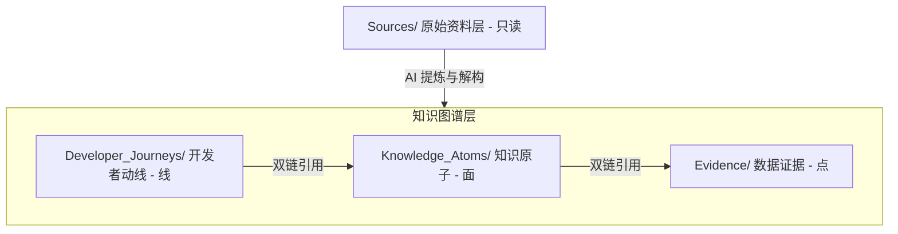
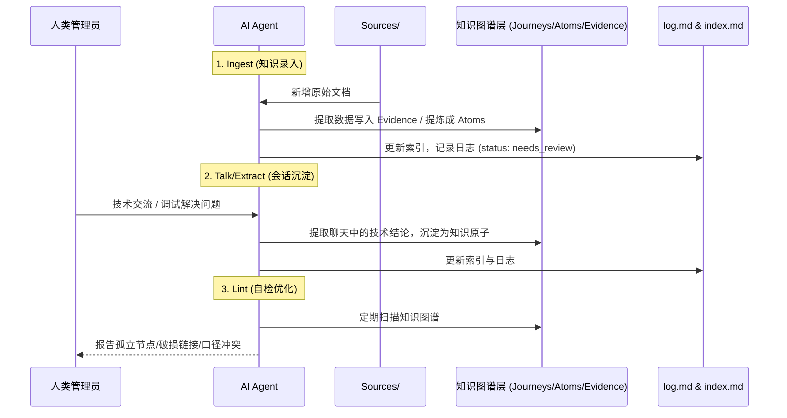

# 知识库维护规范

仅在录入、编辑、同步或审计知识库时读取。普通问答遵循根目录 [Agent.md](../Agent.md)。本规范继承根入口的范围读取、证据核实和用户授权边界。

阶段范围与验收以 [项目计划 v2.0](PROJECT_PLAN.md) 为准：P0/P1 已完成；近期为阶段 A（MCP 自解释与 Skill 瘦身）和阶段 B（存量来源复核与查询驱动迭代），均待执行；公司服务器与 RAG 进入 P4/P5 前须满足环境条件。

## 服务端、用户 Skill 与维护规范的分工

- Worker 是生产服务，负责知识返回、D1 日志、`/stats` 与 `report_wiki_issue`；Python 保持纯标准库的 7 核心工具契约镜像，用于精炼知识离线查询与 CI。两端共享知识语义，不要求复制运营能力。
- 对外 Skill 的目标是稳定的检索与回答规则；硬件参数、节点统计与来源版本由服务器提供，维护命令留在本文件及配套维护文档。阶段 A 的 Skill 瘦身冻结尚未完成，当前安装仍按清单获取完整 Skill。
- `build_meta`、`/health`、节点 `agent_notice` 与搜索 `hint` 是阶段 A 的待实现能力。当前应检查已有元数据，不依赖未来字段；接口边界见 [MCP 契约](MCP_CONTRACT_V1.md)。
- 问答不改写知识或自动发送反馈；查询日志可由 Worker 异步记录。仅在用户明确授权时调用 `report_wiki_issue`，并且接受反馈不代表已成功持久化或完成核查。

## 1. 知识库定位与目标

*   **定位**：**Spacemit LLM Wiki & 产品技术知识库**。它不仅是供开发者阅读的静态文档，更是专为 AI Agent 优化设计的“长效外部记忆体”。
*   **核心目标**：
    1.  **双向易读**：人类通过 Obsidian 的关系图谱、目录索引及清晰的动线进行阅读；AI Agent 可以高效进行语义检索、关系图谱遍历与精准 RAG。
    2.  **知识累积而非碎片收集**：避免每次遇到问题都去检索零散的原始文档。新信息输入时，应主动合并、更新已有的知识节点，让知识库随时间“自我成长”。
    3.  **人机协同**：AI 负责繁琐的文档归类、双链建立、格式整理与自检 (Lint)；人类作为“架构师”，负责定义规范、评估冲突并做最终决策。

---

## 2. 知识分层与目录结构

知识库采用**“线 - 面 - 点”三层隔离架构**。禁止混合不同层级的内容：



| 目录名称 | 角色定位 | 读写权限 | 写作规范 |
| :--- | :--- | :--- | :--- |
| **`Sources/`** | **原始资料层**<br>(Raw Materials) | **只读 (Read-Only)** | 存放未经加工的原始芯片文档与产品文档。**包含 `zh/` 与 `en/` 双语版本，作为原始对照。AI 严禁修改此目录下的任何文件。** |
| **`Developer_Journeys/`** | **开发者上手动线**<br>(The "Lines") | 读写 (Read-Write) | 串联具体任务的“极简通关动线”（如快速上手向导，以及 Muse Pi 等产品上手步骤）。**统一使用中文作为主体语言（关键术语保留英文），只写步骤，细节引用 `Knowledge_Atoms`。** |
| **`Knowledge_Atoms/`** | **知识原子 / 专题档案**<br>(The "Planes") | 读写 (Read-Write) | 围绕特定技术专题或硬件产品的完整认知。**统一以中文为主体（关键术语保留英文），严禁创建平行的中英双套文档。把碎片信息提炼为主题档案，双链引用 `Evidence`。** |
| **`Evidence/`** | **数据与事实证据**<br>(The "Points") | 读写 (Read-Write) | 存放高度原子化的可复用事实（如实测数据、芯片参数、寄存器配置）。**推荐使用中英双语对照表头，内容以符号和标准术语为主，使其天然适配双语引用。** |
| **`static/`** | **静态资源** | 读写 (Read-Write) | 存放文档中引用的图片、图表等静态资源。 |

---

## 3. 文档元数据 (Frontmatter) 规范

知识层 Markdown 文档头部必须包含 YAML 元数据。操作说明、代码与 Skill 文档按各自格式组织。知识层文档的字段如下：

```yaml
---
type: developer_journey | knowledge_atom | evidence | vault_index | vault_log
title: "清晰的中文标题"
domain: chip_product_specs | hardware_schematic_design | bsp_kernel_drivers | bianbu_os_distribution | toolchain_debug_tools | edge_ai_robotics
target_audience: [目标工程师角色, 研发阶段]
status: draft | needs_review | approved | deprecated
created: YYYY-MM-DD
updated: YYYY-MM-DD
aliases: [中文别名, 英文别名, 英文简称] # 必须填入双语别名与常用英文术语，以便跨语言检索与双链绑定
superseded_by: "[[新文档名称]]" # 仅在 status 为 deprecated 时必填
update_note: "一句话说明为什么被替代" # 可选
---
```

### 状态 (Status) 流转说明：
*   **`draft`**：草稿阶段，内容尚不完整。
*   **`needs_review`**：**AI 自动生成或更新内容后的默认状态**，等待人类管理员审核。
*   **`approved`**：人类管理员确认口径无误、可作为正式文档。**AI 无权将状态设为 `approved`。**
*   **`deprecated`**：内容已过期或被新口径替代。**禁止直接删除废弃文档**，须保留并使用 `superseded_by` 指向新文档，以便追溯。

---

## 4. 双向链接与引用规范

为了构建健康的知识图谱并防止链接失效，AI Agent 必须遵循以下链接原则：

1.  **禁止使用 URL 编码的链接**：
    *   ❌ 错误：`[[Knowledge_Atoms/K3%E8%8A%AF%E7%89%87...]]`
    *   ▲ 正确：`[[Knowledge_Atoms/K3热设计与散热专题档案]]`（Obsidian 会自动解析中文路径）。
2.  **强类型引用拓扑与“产品-芯片”关联**：
       *   `Developer_Journeys` 只能引用 `Knowledge_Atoms` 或 `Evidence`。
       *   `Knowledge_Atoms` 可引用其他 `Knowledge_Atoms` 或 `Evidence`。
       *   `Evidence` 不得向上引用 `Knowledge_Atoms` 或 `Developer_Journeys`；任何普通知识节点均不得引用 `Developer_Journeys`。
       *   **产品与芯片双链绑定**：任何关于具体生态产品（如 Muse Pi、K3 Pico）的 `Developer_Journey` 或 `Knowledge_Atom`，**必须**通过双链指向它所基于的芯片级对应节点（例如产品板级设计需关联到芯片外设专题，产品上手动线需关联到芯片专题或事实表，不嵌套其他上手动线）。
       *   **芯片专题向产品延伸**：芯片级的 `Knowledge_Atom` 在阐述完通用技术原理后，应当在合适位置或末尾建立“生态产品应用实例”的双链，指向具体产品的应用设计，完成从“芯片级底层”到“产品级应用”的知识闭环。
3.  **引用的展示风格**：
    *   在正文中引用其他文档时，使用 `[[路径/文件名|显示文本]]` 形式，使段落阅读更自然。例如：“具体热学指标请参考 [[Evidence/k3_thermal_specs|K3 热设计规格参数]]。”
4.  **双语别名与无缝链接**：
    *   在正文引用时，应当利用 YAML 中定义的 `aliases` 进行双链。对于专有名词，推荐使用 `[[中文文档名|英文术语]]` 或直接引用 `[[英文别名]]` 的形式，保证在中英双语语境下的阅读流畅性，同时确保图谱中节点的唯一性。

---

## 5. AI Agent 四类维护工作流

维护任务包含录入、会话沉淀、自检和上游同步。仅执行用户请求或已配置自动化所授权的工作；普通问答不自动录入、同步或发布。



### 工作流一：Ingest (知识录入)
*   **触发场景**：用户要求录入新增的 `Sources/docs-*/` 原始参考资料。先定位变更文件，再按章节读取。
*   **Agent 行为**：
    1.  阅读原始文档，提取其中的核心参数、性能数据、案例事实，写入或更新至 `Evidence/` 目录（若是产品文档，则提取板级规格、物理尺寸、引脚映射等）。
    2.  **硬件管脚与 IOMAP 强制结构化**：若原始文档中包含板卡扩展排针（Header）、连接器（Connector）、管脚复用（Pin Mux / Pinout）信息，Agent **必须**将其从混杂的 HTML/图片形式解构提炼为规范的标准 Markdown 映射表格（包含物理 Pin 号、网络信号名、芯片 GPIO 编号、默认/复用功能、DTS 节点映射），并在 `Knowledge_Atoms/` 下创建或更新对应的 `*_IOMAP管脚映射专题` 知识原子。
    3.  将原始文档中的方法论、设计逻辑提炼，并并入已有的 `Knowledge_Atoms/` 对应主题中（若是产品文档，提炼为产品板级设计专题；同时**自动检索并关联对应的芯片技术专题**，建立双链）。
    4.  **双语交叉比对**：若同时存在中英文原始文档，在提取参数时必须进行交叉比对。若数据一致则提炼入库；若发现两版原始文档数据冲突，触发口径冲突处理流程。
    5.  更新 `index.md` 中的索引，并在 `log.md` 中追加一条操作记录。

### 工作流二：Talk & Extract (会话沉淀)
*   **触发场景**：用户要求把有复用价值的技术会话沉淀入库。区分已验证结论与排查假设，保留验证条件和出处。
*   **Agent 行为**：
    1.  从当前会话历史中提取出“具有复用价值”的技术结论。
    2.  在 `Knowledge_Atoms/` 下新建或更新相关专题档案（例如记录某个 Bug 的排查步骤与最终修复方案）。
    3.  使用双链将该新知识点与已有的 `Evidence` 或 `Knowledge_Atoms` 关联；需要从动线导航时，在对应 `Developer_Journeys` 中增加向该专题的引用。
    4.  在 `log.md` 记录：“从会话中提取并沉淀了 `[[专题名称]]`”。

### 工作流三：Lint & Think (自检优化)
*   **触发场景**：定期运行（或人类管理员手动触发）。
*   **Agent 行为**：
    1.  **链接检查**：运行链接检查脚本检查知识层文件；按诊断定位问题，不将全库正文读入 Agent 上下文。
    2.  **孤立节点检查**：找出没有任何其他文档引用的独立文档 (Orphan Nodes) 并报告。
    3.  **概念与双语冲突检查**：比对不同文档（**包括 `Sources/docs-*/zh/` 与 `Sources/docs-*/en/` 原始文档之间**）对同一技术参数或口径的描述。如果发现冲突（例如中文版与英文版中关于 K3 算力或热阻的描述不一致），在 `log.md` 中进行高亮警告，由人类管理员介入裁决。
    4.  **产品-芯片对齐检查**：扫描所有生态产品文档，确保它们在相关的芯片级专题档案中已被双链引用。如果发现遗漏（如某款产品未在对应的芯片外设或功耗专题中提及），应自动提示并在 `needs_review` 状态下在芯片专题中添加引用。
    5.  **收敛建议**：如果发现多个文档中反复提到了同一个未被定义为双链的关键词，建议将其提炼为新的 `Evidence` 或 `Knowledge_Atom`。

### 工作流四：Upstream Sync & Refactoring (官方 GitHub 上游自动同步与重构)
*   **触发场景**：用户要求检查或同步上游，或运行已授权的同步自动化。“检查更新”只检查与报告；“同步”按范围更新子模块及相关知识。
*   **Agent 核心闭环 SOP**：
    1.  **上游检测与拉取**：Agent 首先检查 `Sources/` 5 大 Git Submodules 的 remote upstream 提交状态（或调用 `update_sources.sh`）。
    2.  **影响范围精准分析**：运行项目工具 `python3 scripts/check_upstream_impact.py`，自动获取：
        - 变更文件清单（`docs-chip`, `docs-buildroot`, `docs-product` 等中的 A/M/D 记录）。
        - **已受影响的现有知识原子**（Knowledge_Atoms）映射关系。
        - **未被覆盖的新增/重大文件**（潜在盲区文档）。
    3.  **知识提炼与档案重构**：
        - **更新现有知识原子**：对受影响的知识档案进行语义级比对，将上游的勘误、新配图、版本参数更新写入对应的 `Knowledge_Atoms/`，并标注 `updated: YYYY-MM-DD`。
        - **新建知识原子**：新领域或产品先列为候选盲区，结合真实查询、授权反馈或明确的关键缺口，定向创建专题；不全量编译所有新增原文。
        - **官方撤文处理**：若上游删除了某篇文档（如撤回热设计指南），不得直接删除对应的知识原子，而应在原知识档案开头添加 `> [!CAUTION]` 撤文警告，并指向替代参考源。
    4.  **索引与日志同步挂载**：
        - 在 `index.md` 的对应技术领域板块挂载新建/更新的知识原子节点。
        - 在 `log.md` 中记录本次同步批次（commit hash、影响的文件清单、同步状态）。
    5.  **校验与发布边界**：
        - 运行 `python3 vault_linker_lint.py`，确保死链为 0、孤立节点为 0。
        - 运行 `python3 scripts/lint_wiki_integrity.py`，检查已编码的文本规则；该正则检查不验证所有事实，关键参数仍需与原始资料核实。
        - 完成请求范围内的修改与校验；提交、推送和部署依据用户授权或已配置自动化，不因本规范自动触发。

---

## 6. 知识库协作红线

1.  **严禁编造**：AI 在提炼和整理知识时，必须完全基于 `Sources/` 或真实会话内容，严禁进行“合理推测”并将其作为事实写入 `Evidence`。
2.  **保留冲突**：当遇到相互矛盾的原始数据（包括中英文档口径不一致）时，AI 不得擅自选择或修改，必须同时保留两份口径，并标记为 `needs_review`，交由人类决定。
3.  **不丢弃历史**：过时的技术方案应标记为 `deprecated` 并不在 `index.md` 主列表中展示，但绝不能物理删除文件，以防历史项目代码中引用的概念彻底断联。
4.  **重大更新同步登记**：在对知识库进行任何重大更新（如并网新产品文档、重构关键专题、大范围修改路径或新增核心节点）时，Agent **必须**同步在 `index.md` 中挂载/注册新节点，并在 `log.md` 中追加详细的变更日志，严禁出现“只建文件、不登索引、不记日志”的遗漏。
5.  **严禁创建平行双语文档**：严禁在 `Developer_Journeys/`、`Knowledge_Atoms/` 或 `Evidence/` 下为同一个技术主题或产品创建平行的中文和英文两套 Markdown 文件（例如同时存在 `K3热设计与散热专题档案.md` 与 `K3_Thermal_Design.md`）。必须合二为一，以中文为主体，通过 `aliases` 和中英对照表头来实现多语言检索与关联。
6.  **商业与非开源信息必须强溯源**：录入或引用任何非官方 GitHub 的商业价格、商务交付、销售策略或未公开客户案例时，必须严格遵守第 7 节规约，明确标注来源与时效，严禁无来源录入与推测。

---

## 7. 非官方 GitHub 资料与商业信息管理规约 (Supplemental Sources & Commercial Data Policy)

为了支持市场、产品培训与商业化场景（如产品定价、购买渠道、商务交期、展会问答），允许在知识库中引入非官方 GitHub 开源仓库的补充事实资料，但必须严格遵守以下准入与管理机制：

### 7.1 资料来源分级 (Source Tiers)
所有录入知识库的补充资料必须根据可信度明确分级：
*   **Tier 1（代码级基线）**：官方 GitHub 开源仓库 (`Sources/docs-*`)，由自动化同步脚本拉取，属于只读技术基线；引用时仍需核对版本、适用板型与可能存在的勘误。
*   **Tier 2（内部官方审批）**：产品定价委员会定稿、飞书官方白皮书、市场部审核的 PR/培训讲稿、展会标准问答手册。**允许沉淀为正式知识原子与事实证据，但必须声明来源与版本**。
*   **Tier 3（一线动态反馈）**：展会口头提问、销售微信群客户咨询、竞品传闻。**仅允许作为“待审核 (needs_review)”条目进入 QA 专题**，未获产品/市场确认前严禁作为正式技术或商业参数发布。

### 7.2 商业与补充信息元数据规范 (Frontmatter 扩展)
凡涉及价格、商务交付、市场培训等非开源 GitHub 来源的文档，YAML 头部必须扩展以下追溯字段：
```yaml
source_tier: tier_1_github_upstream | tier_2_internal_approved | tier_3_field_feedback
source_origin: "资料出处（例如：飞书产品委员会《2026硬件生态指导价》/市场部《产品培训框架.md》）"
effective_until: YYYY-MM-DD       # 商业/价格有效期（到期前需提示复核）
price_nature: public_retail_msrp | enterprise_inquiry | nda_confidential # 公开零售价/大客户询价/NDA保密
maintainer: "业务负责人姓名/岗位"
external_use: false # 事实是否适合对外引用；不替代下面的发布权限
publication: false # 阻止条目进入公共 MCP；内部 tier 2/3、NDA 默认也排除
```

### 7.3 AI Agent 商业应答安全行为红线 (Agent Commercial Safety Rules)
当 AI Agent 在检索并应答涉及“价格、购买渠道、国内流片节点、融资”等敏感非技术问题时，必须执行以下行为准则：
1.  **时效性校验与免责声明**：若商业或价格条目已超过 `effective_until`（有效日期），AI 必须在回复中主动声明：“*以上为历史参考指导信息，最新批次报价与交付周期请以官方销售对接为准*”。
2.  **严禁主观推测定价**：未录入公开建议零售价（MSRP）的产品，严禁 AI 根据竞品或芯片成本进行猜测，统一输出：“*该产品面向行业客户提供样片/样机定制，具体商务方案请联系官方商务 (sales@spacemit.com)*”。
3.  **敏感商业与战略议题转介**：涉及未公开芯片代际（如 K5/K7 规划）、国内特定流片晶圆厂细节、股权融资估值等未官宣事项，AI 必须严格输出市场部/公司公关已备案的公开口径，绝不展开未经证实的细节推演。


## 8. MCP 索引与维护校验

- 更新知识层或 Sources 后运行 `python3 scripts/build_mcp_index.py` 和 `python3 scripts/build_mcp_index.py --check`；构建保留来源、状态、更新时间和使用范围。构建必须有完整未修改的 Sources；消费设备使用已发布索引，无源时不得重新覆盖。
- 公共索引排除 tier 2/3、NDA、`publication:false` 或内部 visibility；公开条目不可引用这些节点。`external_use:false` 的上游技术条目作为待核验证据保留，不应对外承诺。
- 来源元数据按确有依据填写：`source_origin`、`source_file`（完整路径）、`source_commit`、`source_section` 或 `source_locator`、`source_resolution`、`verification_status`、`verified_at`、`conflicts`。来源无法确定时标 `unresolved / unverified`；定位到文件不等于逐项核验。
- 本地同步脚本先更新子模块再重建验证索引；CI将这两者共同提交并显式调用部署工作流，部署精确 commit。不要假设 GITHUB_TOKEN 的 push 会触发另一份 push 工作流。
- 保留已配置 CI 对 Sources 指针、两份索引与影响基线的自动提交推送，以及派生报告和部署流程；不允许无人审阅的 AI 正文改写或事实来源 SHA/核验状态升级后自动发布。自动同步成功不是事实已批准。
- 版本底座为 Git 与双端一致索引，不另建 `wiki-release/<version>` 目录。当前索引已有构建时间、来源 SHA 与内容哈希；阶段 A 再补确定性聚合 `build_meta`。回退线上需重新部署目标 ref 对应代码、索引及固定 Sources，随后验证版本与核心调用；本地 revert 不会切换服务。
- `python3 vault_linker_lint.py` 检查链接、元数据和引用方向；`python3 scripts/lint_wiki_integrity.py` 检查有限的表达规则。二者均不能替代事实核查。
- 原始出处优先记录仓库、文件路径、章节与 commit；`main` URL 代表实时版本，不能证明历史参数。
- 新增节点同步挂载 `index.md`，重大维护记录到 `log.md`；资料撤回时保留历史并标明替代出处。


来源定位与事实认证分别记录：`source_resolution: resolved` 表示文件/章节已定位，`partial` 表示只覆盖部分结论，`unresolved` 表示出处未定位，均不自动等于 `verification_status: verified`。`source_checked_at` 是定位检查日期；仅完成实际事实复核时填写 `verified_at`。跨文件的补充出处可用 `source_related_file / source_related_commit`，无法核实的指标单独标注。

构建器支持顶层标量、别名/读者列表和来源路径/commit 平行列表；不支持的嵌套 YAML、块标量或重复字段会拒绝构建，不能静默绕过发布策略。完整字段透传不表示已自动认证其内容。

P1 的来源字段、JSON 报告、分页边界与 stale 复核命令见 [新鲜度与维护闭环](FRESHNESS_MAINTENANCE.md)。

## 9. 阶段 B 的日常内容闭环

先处理当前索引中的 12 个 stale，区分非实质变更、事实/命令变化与迁移/撤回；再为 7 篇 Journey 补适用来源锚点。逐项保留 diff、核查范围与未解决原因，不为清零批量刷新 SHA，不把 `current` 当作人工批准。

定期查看 `/stats` 或 D1 的未命中、原文高频读取与授权反馈：先判断叫法差异再补 aliases，确认真实盲区后才扩写节点。当前原文调用次数包含分页和主动核实，缺少会话关联时不能直接宣称回退率下降；记录统计窗口与口径，D1 绑定也不能证明实际读写成功。

20 题评测须覆盖 6 个 domain，并记录来源、产品/版本、审核/新鲜度状态与实际结果。普通题以 1～3 次调用为目标，证据不足继续必要核实或说明未知；现有 Skill 评测样例不是已通过报告。具体任务与验收见 [项目计划阶段 B](PROJECT_PLAN.md)。
